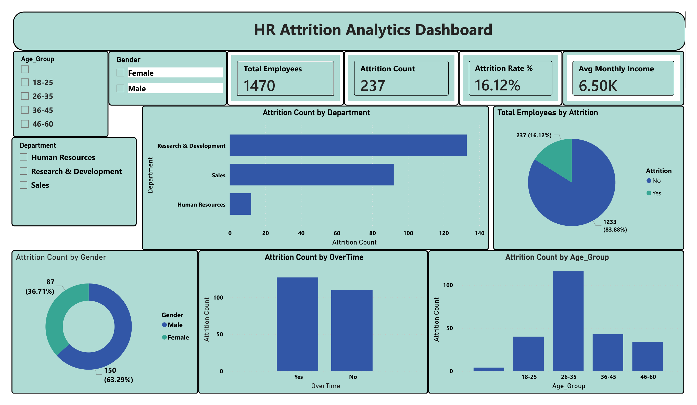
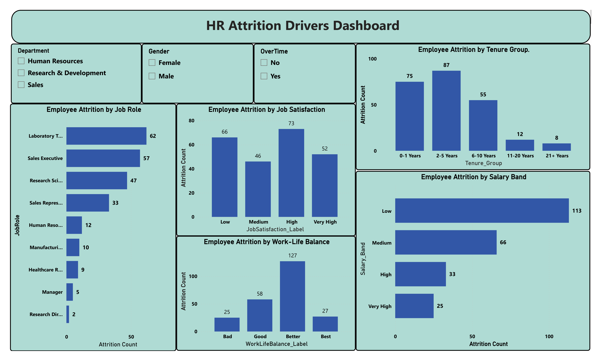

# 📊 HR Attrition Analytics Dashboard

> **Understanding employee attrition patterns through Python, Exploratory Data Analysis and Power BI**


---

## 🧩 Business Problem

Employee attrition is an important business challenge that affects workforce stability, recruitment costs and organizational performance.

This project analyzes employee attrition patterns using the IBM HR Analytics Employee Attrition dataset. Python was used for data cleaning and exploratory data analysis, while Power BI was used to create an interactive dashboard for business reporting.

The project focuses on three key questions:

- **Who is leaving?** Which departments, age groups, job roles and salary bands have higher attrition?
- **What patterns are associated with attrition?** How do job satisfaction, work-life balance, overtime and employee tenure relate to employee attrition?
- **Where should HR focus?** Which employee segments could benefit from targeted retention initiatives?

---

## 🎯 Project Objectives

- Perform data cleaning and preprocessing using Python.
- Conduct exploratory data analysis (EDA).
- Analyze employee demographics and job-related factors.
- Identify attrition patterns across different employee segments.
- Develop an interactive two-page Power BI dashboard.
- Present business insights to support HR decision-making.

---

## 🔍 Key Findings

The dataset contains 1,470 employee records, including 237 employees who left the organization.

| Metric | Result |
|---|---:|
| Total Employees | 1,470 |
| Employees Who Left | 237 |
| Employees Retained | 1,233 |
| Overall Attrition Rate | **16.12%** |
| Retention Rate | **83.88%** |
| Average Monthly Income | 6,503 |
| Highest Department Attrition Rate | Sales – 20.63% |
| Highest Age Group Attrition Rate | 18–25 – 35.77% |
| Highest Work-Life Balance Attrition Rate | Bad – 31.25% |
| Highest Early-Tenure Attrition Rate | 0–1 Years – 34.88% |

### Department Insights

- Sales recorded the highest attrition rate at 20.63%.
- Human Resources recorded an attrition rate of 19.05%.
- Research & Development recorded an attrition rate of 13.84%.

### Age Group Insights

- Employees aged 18–25 had the highest attrition rate at 35.77%.
- Employees aged 26–35 recorded an attrition rate of 19.14%.
- Employees aged 36–45 recorded an attrition rate of 9.19%.
- Employees aged 46–60 recorded an attrition rate of 12.45%.

### Job Satisfaction Insights

- Employees with Low job satisfaction had an attrition rate of 22.84%.
- Employees with Medium job satisfaction had an attrition rate of 16.43%.
- Employees with High job satisfaction had an attrition rate of 16.52%.
- Employees with Very High job satisfaction had an attrition rate of 11.33%.

### Work-Life Balance Insights

- Employees reporting Bad work-life balance had an attrition rate of 31.25%.
- Good work-life balance recorded an attrition rate of 16.86%.
- Better work-life balance recorded an attrition rate of 14.22%.
- Best work-life balance recorded an attrition rate of 17.65%.

### Employee Tenure Insights

The grouped tenure analysis showed the following attrition counts:

| Tenure Group | Employees Who Left |
|---|---:|
| 0–1 Years | 75 |
| 2–5 Years | 87 |
| 6–10 Years | 55 |
| 11–20 Years | 12 |
| 21+ Years | 8 |

*These findings describe patterns and associations in the dataset. They do not establish that individual factors directly cause employee attrition.*

---

## 🛠️ Tech Stack

| Layer | Tools Used |
|---|---|
| Programming | Python |
| Data Manipulation | Pandas, NumPy |
| Data Cleaning | Python |
| Exploratory Data Analysis | Jupyter Notebook |
| Data Visualization | Matplotlib, Seaborn |
| Business Intelligence | Microsoft Power BI |
| Data Transformation | Power Query |
| Calculations | DAX |
| Dataset | IBM HR Analytics Employee Attrition Dataset |

---

## 🏗️ Project Workflow

The project follows an end-to-end analytics workflow:

```text
IBM HR Analytics Dataset
          |
          ▼
    Python / Pandas
          |
          ▼
     Data Cleaning
          |
          ▼
 Exploratory Data Analysis
          |
          ▼
  Data Visualization
          |
          ▼
   Cleaned CSV Export
          |
          ▼
    Power BI Desktop
          |
          ▼
   Data Model & DAX
          |
          ▼
 Interactive Dashboard
          |
          ▼
   Business Insights
```

---

## 📁 Project Structure

```text
HR-Attrition-Analytics/
│
├── screenshots/
│   ├── HR_Attrition_Overview.png
│   ├── HR_Attrition_Drivers.png
│   └── README.md
│
├── HR_Attrition_EDA.ipynb
├── HR_Attrition_Clean.csv
├── WA_Fn-UseC_-HR-Employee-Attrition.csv
├── HR_Attrition_Dashboard.pbix
├── HR_Attrition_Dashboard .pdf
└── README.md
```

---

## 📊 Dashboard Screenshots

The Power BI dashboard contains two interactive pages.

### 1. HR Attrition Analytics Dashboard

Provides a high-level overview of employee attrition through four KPI cards:

- Total Employees
- Attrition Count
- Attrition Rate
- Average Monthly Income

Visualizations include:

- Employee Attrition Count by Department
- Total Employees by Attrition
- Attrition Count by Gender
- Attrition Count by Overtime
- Attrition Count by Age Group
- Employee Attrition Rate by Department
- Employee Attrition Rate by Age Group



### 2. HR Attrition Drivers Dashboard

Explores employee attrition patterns across different job-related factors.

Visualizations include:

- Employee Attrition by Job Role
- Employee Attrition by Job Satisfaction
- Employee Attrition by Work-Life Balance
- Employee Attrition by Tenure Group
- Employee Attrition by Salary Band

Interactive slicers allow users to filter the analysis by:

- Department
- Gender
- Overtime



### 📄 Dashboard Report

View the complete two-page Power BI dashboard in PDF format:

[**View HR Attrition Dashboard PDF**](HR_Attrition_Dashboard%20.pdf)

---

## ⚙️ Key DAX Measures

The following DAX measures were used in the Power BI dashboard.

### 1. Total Employees

```dax
Total Employees =
COUNTROWS('HR_Attrition_Clean')
```

### 2. Attrition Count

```dax
Attrition Count =
SUM('HR_Attrition_Clean'[Attrition_Flag])
```

### 3. Attrition Rate

```dax
Attrition Rate % =
DIVIDE(
    [Attrition Count],
    [Total Employees],
    0
)
```

Format this measure as a percentage with two decimal places.

### 4. Average Monthly Income

```dax
Avg Monthly Income =
AVERAGE('HR_Attrition_Clean'[MonthlyIncome])
```

---

## 🚀 How to Reproduce the Project

### Prerequisites

- Python 3.x
- Jupyter Notebook
- Microsoft Power BI Desktop

### Step 1 – Clone the Repository

```bash
git clone https://github.com/chandu2627/HR-Attrition-Analytics.git
```

### Step 2 – Install Python Libraries

```bash
pip install pandas numpy matplotlib seaborn jupyter
```

### Step 3 – Run the Python Notebook

1. Open `HR_Attrition_EDA.ipynb` in Jupyter Notebook.
2. Keep the original dataset in the project folder.
3. Run the notebook cells to perform data cleaning and exploratory analysis.
4. Generate the cleaned dataset.

### Step 4 – Open Power BI Dashboard

1. Open `HR_Attrition_Dashboard.pbix` in Power BI Desktop.
2. If required, update the source path to `HR_Attrition_Clean.csv`.
3. Refresh the data.
4. Explore both dashboard pages using the interactive slicers.

---

## 💡 Business Recommendations

Based on the observed attrition patterns, HR teams could consider:

- Reviewing retention strategies within the Sales department.
- Improving onboarding and employee support for early-tenure employees.
- Investigating employee concerns associated with low job satisfaction.
- Reviewing workload allocation and work-life balance practices.
- Examining compensation, career development and growth opportunities across employee segments.

These recommendations should be validated using additional organizational information before implementation.

---

## 📝 Data Notes

- The dataset contains 1,470 employee records and 35 original columns.
- The cleaned dataset contains 44 columns, including additional analytical fields.
- `Attrition_Flag` represents employee attrition as a numerical indicator.
- Age groups, salary bands, job satisfaction labels and work-life balance labels were created for analysis.
- Tenure groups were created to make employee experience analysis easier to interpret.
- The project uses a publicly available IBM HR Analytics dataset.

---

## 🔮 Future Improvements

- Develop additional employee-level attrition risk analysis.
- Explore relationships between compensation, job roles and attrition.
- Add more detailed workforce segmentation.
- Build predictive attrition models using machine learning.
- Expand the dashboard with additional HR performance indicators.

---

## 👤 About

**Polnati Chandu Manikanta Narasimha**

Aspiring Data Analyst | Python | SQL | Power BI | Excel

📍 Hyderabad, India

[LinkedIn](https://www.linkedin.com/in/chandumanikanta) · [GitHub](https://github.com/chandu2627)

---

## 📚 Dataset Source

[IBM HR Analytics Employee Attrition Dataset – Kaggle](https://www.kaggle.com/datasets/pavansubhasht/ibm-hr-analytics-attrition-dataset)

---

**Project:** HR Attrition Analytics Dashboard  
**Focus:** HR Analytics | Exploratory Data Analysis | Business Intelligence  
**Tools:** Python | Pandas | NumPy | Matplotlib | Seaborn | Power BI | DAX
